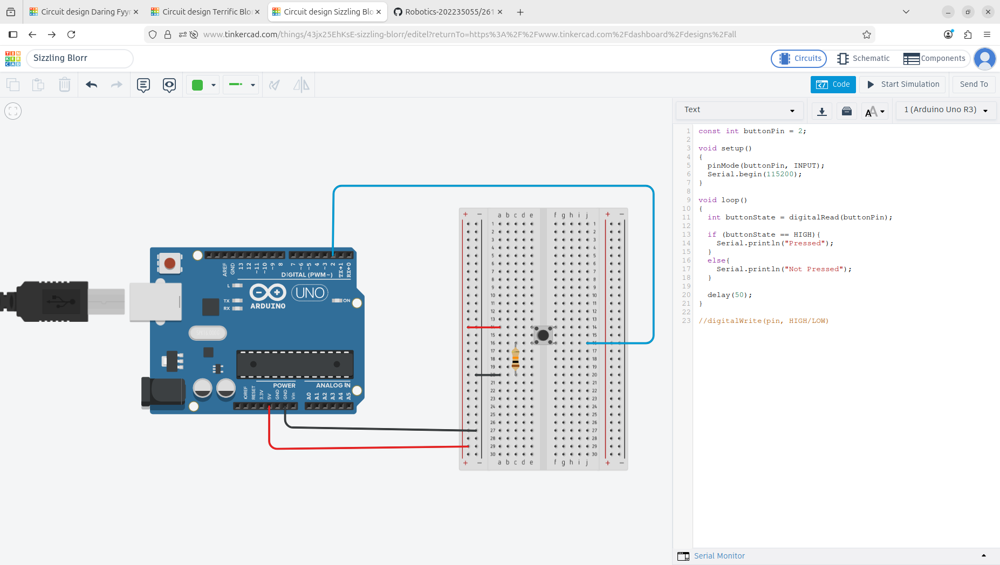
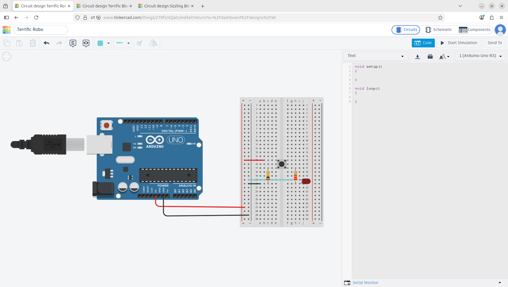
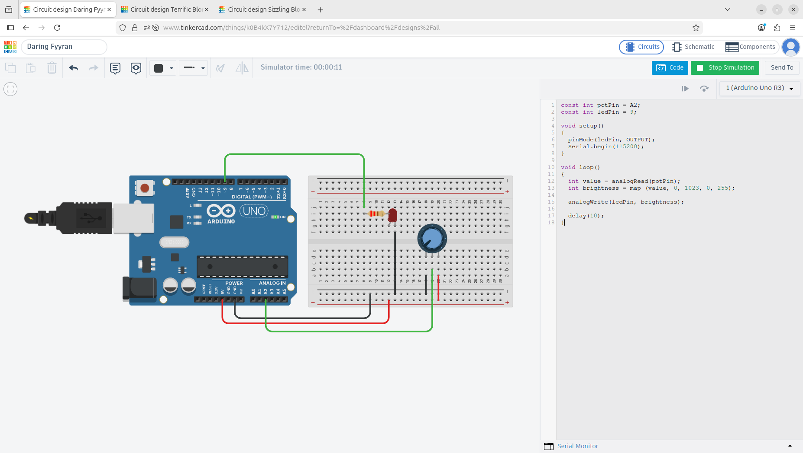

# 실습 #2 — 버튼, 가변저항 및 서보모터 제어

## 1. 학습 내용 및 이론적 배경

- **레지스터와 입출력:** MCU는 레지스터를 통해 핀의 방향과 출력 상태 등을 관리한다. DDR(Data Direction Register)은 일부 MCU에서 입력, 출력 방향을 지정하는 레지스터이다.
- **Floating, Pull-up/Pull-down:** 디지털 입력 핀이 연결되지 않으면 값이 불안정해질 수 있다. Pull-up은 기본 상태를 `HIGH`, Pull-down은 `LOW`로 유지하도록 한다.
- **Bouncing 및 Debouncing:** 짧은 시간 동안 여러 번 신호가 튀는 현상이 Bouncing이다. 이를 완화하는 과정이 Debouncing이다.
- **Serial 통신:** 데이터를 한 비트씩 전송하는 직렬 통신 방식이다. `Serial.begin(115200)`은 baud rate를 설정한다.
- **ADC와 PWM:** Arduino 실습의 `analogRead()` 값은 10비트(0~1023)이며, `analogWrite()`에 전달하는 밝기 값은 8비트(0~255)이다. PWM은 신호의 Duty Cycle을 조절하여 평균적인 출력 효과를 만든다.

## 2. 실습 내용 및 핵심 기술

| 파일 | 구현 내용 |
|---|---|
| `Button.cpp` | 2번 핀의 디지털 입력을 읽어 시리얼 모니터에 `Pressed` 또는 `Not Pressed` 출력 |
| `Potentiometer.cpp` | A2 핀의 가변저항 값을 `map()`으로 0~255 범위에 변환하여 9번 핀 LED의 PWM 밝기 제어 |
| `Arduino_Codes/servo_sweep.ino` | ESP32 14번 핀의 서보모터에 0~180도 왕복 각도 명령 전송(3도 간격) |
| `Arduino_Codes/Servo_Potentiometer.ino` | ESP32 39번 핀의 ADC 값(0~4095)을 0~180도로 변환해 14번 핀 서보모터 각도 제어 |

## 3. 수행 과정 및 결과 분석

1. 버튼의 `HIGH`/`LOW` 상태를 `digitalRead()`로 읽고 `Serial.println()`으로 출력하도록 작성하였다.
2. 가변저항의 아날로그 입력을 읽고 `map(value, 0, 1023, 0, 255)`로 PWM 값에 맞게 변환하였다.
3. `ESP32Servo` 라이브러리를 이용하여 서보모터 각도를 제어하고, 가변저항 값을 각도에 대응시켰다.

버튼 입력은 배선 및 Pull-up/Pull-down 구성에 따라 값이 불안정할 수 있으므로 확인이 필요하다. 또한 `servo_sweep.ino`에는 각도 변경 사이의 대기 시간이 없어 실제 모터가 명령된 중간 각도를 모두 따라가지 못할 수 있다.

### 실습 화면

## 4. 파일 구조

- `Button.cpp`, `Potentiometer.cpp`: 버튼 및 가변저항 실습 코드
- `Arduino_Codes/`: ESP32 서보모터 제어 코드 2개
- `Button.png`, `Button_to_LED.png`, `Potentiometer.png`: 실습 화면
- `README.md`: 실습 기술문서

## 5. 실행 방법 및 참고 사항

- **버튼/가변저항 실습:** Arduino 호환 개발 환경에서 각 `.cpp` 코드를 스케치로 실행한다. 버튼 입력은 2번 핀, 가변저항 입력은 A2, LED 출력은 9번 핀을 사용한다. 시리얼 모니터는 **115200 baud**로 설정한다.
- **ESP32 서보모터 실습:** Arduino IDE에서 ESP32 보드 환경 및 `ESP32Servo` 라이브러리를 설치한 뒤 `.ino` 파일을 실행한다. 서보 신호 핀은 GPIO 14, 가변저항 입력은 GPIO 39를 사용한다. 보드와 부품의 전원 및 공통 접지 연결을 확인한다.
